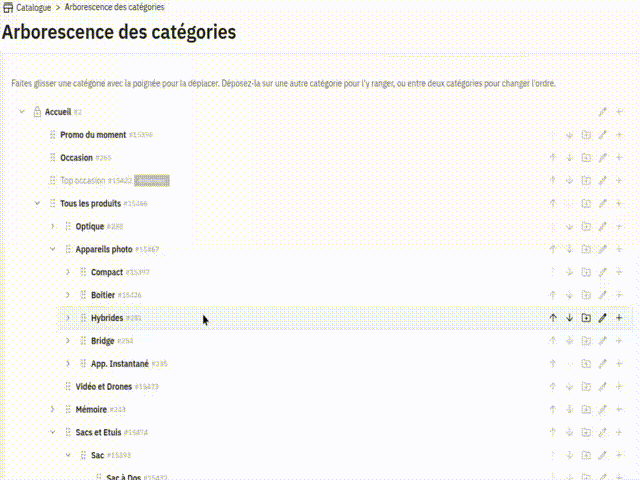

# Module Arborescence des catégories

Ce module PrestaShop permet de réorganiser l'arborescence des catégories par glisser-déposer depuis une page unique du
back-office. Chaque déplacement (changement d'ordre ou de catégorie parente) est appliqué immédiatement et peut être
annulé.

  

## Fonctionnalités

- Affiche l'arbre complet des catégories à partir de la catégorie Accueil, dans la langue de l'employé
- Arbre repliable, avec un état de repli mémorisé dans le navigateur
- Recherche qui filtre l'arbre et déplie les branches correspondantes
- Catégories désactivées grisées avec un badge « désactivée », catégorie Accueil verrouillée
- Glisser-déposer avec trois zones : avant, après et dans une catégorie
- Alternative clavier et tactile : boutons Monter / Descendre et action « Déplacer vers… »
- Confirmation demandée avant tout changement de catégorie parente
- Notification « Catégorie déplacée » avec un bouton **Annuler** pendant 8 secondes
- Liens directs vers les pages natives « Modifier » et « Ajouter une sous-catégorie »

## Sécurité et intégrité des données

- Le changement de parent passe par la commande native `EditCategoryCommand` : le nested set (`nleft`, `nright`),
  `level_depth` et le hook `actionCategoryUpdate` sont gérés par le cœur de PrestaShop
- Les positions sont réécrites de façon contiguës dans `category_shop` et `category`, dans une transaction
- Déplacement d'une catégorie dans l'une de ses sous-catégories refusé
- Détection des modifications concurrentes : si l'arbre a changé entre-temps, il est rechargé au lieu d'être écrasé
- Déplacement réservé aux employés ayant le droit de modification sur les catégories

## Installation

1. Téléchargez le module
2. Décompressez-le dans le dossier `/modules` de votre installation PrestaShop (le dossier doit s'appeler `categorytree`)
3. Installez le module depuis le back-office de PrestaShop
4. La page est accessible via **Catalogue > Arborescence des catégories**

## Configuration requise

- PrestaShop 9.1 ou plus récent
- PHP 8.1 ou plus récent
- Boutique unique : le module se désactive automatiquement si le multiboutique est activé

## Utilisation

1. Ouvrez **Catalogue > Arborescence des catégories**
2. Faites glisser une catégorie avec sa poignée :
    - entre deux catégories pour changer l'ordre ;
    - sur la zone « Déposer dans… » d'une catégorie pour la ranger dedans
3. Confirmez si la catégorie change de parent
4. En cas d'erreur, cliquez sur **Annuler** dans la notification

## Screenshot

## License

> This program is free software; you can redistribute it and/or modify it under the terms of the GNU General Public
> License, version 3, as published by the Free Software Foundation.
>
> This program is distributed in the hope that it will be useful, but WITHOUT ANY WARRANTY; without even the implied
> warranty of MERCHANTABILITY or FITNESS FOR A PARTICULAR PURPOSE. See the GNU General Public License for more details.

A copy of the license is included in the root of the module's directory. The file is named `LICENSE`.

## Crédits

### Answeb - Développement du module

Ce module a été développé par [Answeb](https://www.answeb.net), agence spécialisée dans le développement web et les
solutions e-commerce. Answeb accompagne les entreprises dans leur transformation digitale en créant des solutions
sur-mesure adaptées à leurs besoins spécifiques.

**Expertise Answeb :**

- Développement WordPress & WooCommerce, Prestashop
- Intégrations ERP et solutions métier
- Connecteurs et API personnalisés
- Solutions e-commerce avancées

Pour toute question technique ou demande d'évolution du module, vous pouvez contacter l'équipe Answeb via notre
site web.

### SortableJS

Le glisser-déposer utilise [SortableJS](https://github.com/SortableJS/Sortable) (licence MIT), embarqué dans
`views/js/vendor/`.

## Contribution

Les contributions sont les bienvenues ! Si vous souhaitez contribuer à ce projet, faites une pull request sur la branche
develop. Vous devriez également ouvrir une issue pour documenter votre contribution.
